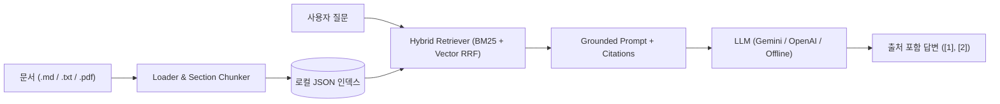

# DocQA Assistant

개인 노트와 기술 문서(`.md`, `.txt`, `.pdf`)를 색인화하고, 질문에 대해 **근거 출처(`[1]`, `[2]`)와 함께 답변**하는 하이브리드 RAG Q&A 어시스턴트입니다.

## 주요 특징

- **섹션 인식 청킹(Section-Aware Chunking)**: Markdown 헤딩(`#`, `##` 등)을 보존해 출처 파일명과 섹션 제목을 함께 추적합니다.
- **하이브리드 검색(BM25 + Dense Vector RRF)**:
  - 한국어/영어 바이그램(2-gram)을 지원하는 순수 Python BM25 검색으로 API 키 없이도 동작합니다.
  - Gemini / OpenAI 임베딩 활성화 시 Reciprocal Rank Fusion(RRF)으로 어휘 검색과 의미 검색을 결합합니다.
- **멀티 LLM & 오프라인 모드**: `gemini`, `openai`, `offline`(API 키 없는 추출 요약 모드) 전환을 지원합니다.
- **CLI & FastAPI 웹 UI**: 터미널 CLI와 웹 대시보드(`/`)를 모두 제공합니다.
- **검색 품질 평가(Eval)**: `evals/run_eval.py`로 Hit@K 및 MRR을 측정할 수 있습니다.

## 아키텍처



## 빠른 시작

### 1. 설치

```bash
python -m venv .venv
# Windows: .venv\Scripts\activate
# macOS/Linux: source .venv/bin/activate
pip install -r requirements.txt
```

### 2. 환경 변수 설정

```bash
cp .env.example .env
```

`.env`에서 원하는 모드를 설정합니다.
- `DOCQA_LLM_PROVIDER=offline` (기본값, API 키 없이 바로 실행 가능)
- `DOCQA_LLM_PROVIDER=gemini` (`GEMINI_API_KEY` 설정 필요)
- `DOCQA_LLM_PROVIDER=openai` (`OPENAI_API_KEY` 설정 필요)

### 3. CLI 실행

```bash
# 샘플 문서 인덱싱
python -m docqa.cli index ./sample_docs

# 질문하기
python -m docqa.cli ask "하이브리드 검색기는 어떻게 동작하나요?"

# 웹 서버 실행 (http://127.0.0.1:8000)
python -m docqa.cli serve
```

### 4. 테스트 및 검색 평가

```bash
python -m unittest discover -s tests
python -m evals.run_eval
```

## API 엔드포인트

| Method | Path | 설명 |
| :--- | :--- | :--- |
| `GET` | `/api/health` | 서버 상태, 활성 LLM 제공자, 인덱싱된 청크 수 확인 |
| `GET` | `/api/docs` | 현재 인덱싱된 문서 목록 및 청크 수 조회 |
| `POST` | `/api/index` | 지정 폴더(`docs_dir`) 문서 색인화 |
| `POST` | `/api/ask` | 질문에 대한 답변 및 출처(`citations`) 반환 |

## 프로젝트 구조

```text
docqa-assistant/
├── docqa/
│   ├── api.py          # FastAPI 서버 및 정적 웹 UI 서빙
│   ├── cli.py          # CLI 엔트리포인트 (index / ask / docs / serve)
│   ├── config.py       # 환경 변수 설정 로더
│   ├── llm.py          # Gemini / OpenAI / Offline 생성기
│   ├── loader.py       # Markdown / Text / PDF 로더 및 섹션 청커
│   ├── retriever.py    # BM25 + 선택적 벡터 RRF 하이브리드 검색기
│   ├── service.py      # 인덱싱 및 Q&A 오케스트레이션 서비스
│   └── static/index.html
├── evals/              # 검색 정확도 평가 데이터셋 및 스크립트 (Hit@K, MRR)
├── sample_docs/        # 바로 테스트 가능한 샘플 기술 문서
├── tests/              # 단위 및 통합 테스트
├── Dockerfile
├── pyproject.toml
└── requirements.txt
```

## 라이선스

이 프로젝트는 [MIT License](LICENSE)를 따릅니다.

